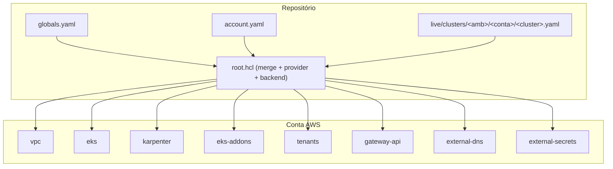
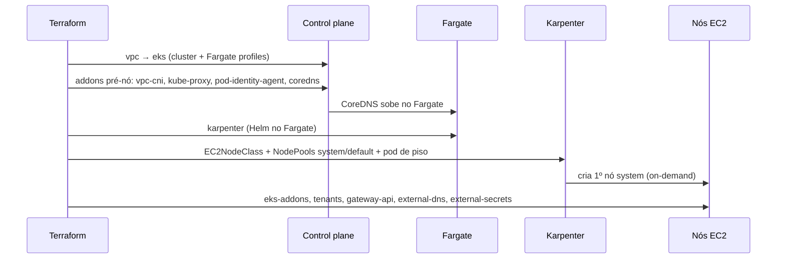
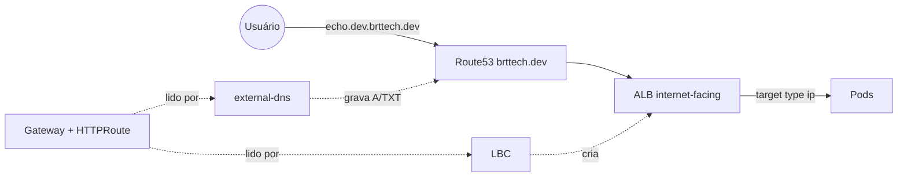

# Arquitetura

## Visão geral



Cada pasta em `live/stacks/` é uma stack Terragrunt com state próprio em
`s3://eks-blueprint-tfstate-<account_id>/eks-blueprint/<cluster>/<stack>/terraform.tfstate`
(lock nativo do S3). As stacks chamam os módulos de `modules/`.

### Como o cartão vira configuração

`root.hcl` resolve o cluster a partir de `TG_CLUSTER` (o nome do cluster):

1. procura `live/clusters/*/*/<TG_CLUSTER>.yaml` e exige exatamente um resultado;
2. faz o merge raso `globals.defaults` ← `account.yaml` ← `<cluster>.yaml`;
3. tira do caminho `environment` (1ª pasta), `account_name` (2ª pasta) e `cluster_name` (nome do arquivo);
4. junta as access entries (globais + conta + cluster + tenants);
5. gera `provider.tf` com `allowed_account_ids = [account_id]` e as tags default;
6. gera `backend.tf` apontando para o bucket da conta.

Stacks que falam com o Kubernetes incluem `live/_common/k8s.hcl`, que gera os providers
`kubernetes`, `helm` e `kubectl` a partir de um `data "aws_eks_cluster"`. A autenticação usa
`aws eks get-token`.

## Ordem de bootstrap



O ponto delicado é a ordem: **nenhum managed node group existe**. Por isso:

- O **Karpenter e o CoreDNS rodam no Fargate**. O Karpenter precisa de DNS para chamar as APIs da
  AWS, então o CoreDNS sobe antes dele.
- **vpc-cni, kube-proxy e eks-pod-identity-agent** são DaemonSets. Eles ficam ACTIVE com zero nós e já
  estão prontos quando o primeiro EC2 entra.
- `bootstrap_self_managed_addons = false`: todos os addons core são `aws_eks_addon`, com versão fixada
  no cartão.
- O stack `karpenter` termina só quando existe **1 nó `system` Ready**. Os stacks seguintes podem
  instalar Helm charts com `wait = true`.

Ordem completa (é a do `scripts/apply-cluster.sh`):

```
vpc → eks → karpenter → eks-addons → tenants → gateway-api → external-dns → external-secrets → argocd
```

## Rede

```
VPC /16 (ex.: 10.10.0.0/16)
├── bloco /19 #0 → subnets públicas /24 por AZ   (ALB/NLB internet-facing, NAT)
├── bloco /19 #1 → privada AZ-a /19              (nós, pods, ALB interno)
├── bloco /19 #2 → privada AZ-b /19
├── bloco /19 #3 → privada AZ-c /19
└── blocos /19 #4–#7 → reservados
```

- As privadas são grandes porque o VPC CNI dá **um IP da VPC por pod**.
- **NAT:** `single` (1 NAT, barato; perder a AZ derruba o egress) ou `per_az`. prd exige `per_az`.
- **Endpoint S3 gateway** sempre presente (grátis). As camadas das imagens do ECR vêm do S3 e não passam pelo NAT.
- **Interface endpoints** (ECR, STS, EC2, SQS, …) são opcionais por cartão. Custam cerca de US$7/mês por serviço por AZ.
- **Flow logs** opcionais, no CloudWatch com retenção.
- **SG default** da VPC sem regras.
- **Tags:** subnets privadas com `karpenter.sh/discovery=<cluster>` e `kubernetes.io/role/internal-elb`;
  públicas com `kubernetes.io/role/elb`. O SG do cluster também recebe `karpenter.sh/discovery`.
- **NetworkPolicy** habilitada no VPC CNI (`enableNetworkPolicy`).

## Compute (Karpenter)

| NodePool | Capacidade | Taint | Para quê | Consolidação |
|---|---|---|---|---|
| `system` | on-demand, ≥ 2 vCPU, famílias c/m/r geração > 5 | `CriticalAddonsOnly:NoSchedule` | controllers de plataforma | 10 min, 1 nó por vez |
| `default` | spot + on-demand (cartão), c/m/r geração > 5 | — | workloads | 1 min, até 10% dos nós |

- **EC2NodeClass `default`:** AMI fixa pelo cartão (`al2023@vYYYYMMDD`), IMDSv2 com hop limit 1 (pods
  não leem credenciais do nó), disco gp3 de 40 GiB criptografado, instance profile criado pelo
  Terraform e tags do cartão replicadas nas EC2.
- **Piso de capacidade:** o deployment `karpenter-bootstrap/system-capacity-floor` (um `pause`)
  mantém pelo menos 1 nó `system`.
- **Interrupção:** EventBridge (Spot interruption, rebalance, mudança de estado, AWS Health) → SQS
  → Karpenter, que drena o nó antes de ele sumir.
- **Componentes de plataforma** usam `nodeSelector: karpenter.sh/nodepool=system` + toleration
  `CriticalAddonsOnly`. O LBC também espalha as réplicas entre nós (obrigatório) e AZs (preferencial).

## Componentes

| Componente | Stack | Onde roda | Identidade AWS | Versão vem de |
|---|---|---|---|---|
| vpc-cni | eks | DaemonSet | Pod Identity | `eks_addon_versions` |
| kube-proxy | eks | DaemonSet | — | `eks_addon_versions` |
| coredns | eks | Fargate | — | `eks_addon_versions` |
| eks-pod-identity-agent | eks | DaemonSet | — | `eks_addon_versions` |
| Karpenter | karpenter | Fargate | **IRSA** (Fargate não suporta Pod Identity) | `karpenter_version` |
| aws-ebs-csi-driver + StorageClass `gp3` default | eks-addons | system | Pod Identity | `eks_addon_versions` |
| metrics-server | eks-addons | system | — | `eks_addon_versions` |
| eks-node-monitoring-agent | eks-addons | DaemonSet | — | `eks_addon_versions` |
| amazon-cloudwatch-observability (opcional) | eks-addons | DaemonSet | Pod Identity | `eks_addon_versions` |
| namespaces de tenants | tenants | — | — | — |
| AWS Load Balancer Controller + GatewayClass `aws-alb`/`aws-nlb` | gateway-api | system | Pod Identity | `chart_versions` |
| CRDs Gateway API + LBC | gateway-api | — | — | `modules/gateway-api/crds/` (no repo) |
| external-dns | external-dns | system | Pod Identity | `chart_versions` |
| External Secrets + ClusterSecretStores | external-secrets | system | Pod Identity (+ role por tenant) | `chart_versions` |
| Argo CD (opcional) | argocd | system | — | `chart_versions` |

## Ingress e DNS



- **Gateway API** com `GatewayClass aws-alb` (L7) e `aws-nlb` (L4). O ALB é configurado por
  `LoadBalancerConfiguration` (scheme, listeners, certificado ACM). `certificateRefs` do Gateway não
  é suportado pelo LBC.
- **external-dns** publica em `<environment>.<domain_name>` (ex.: `dev.brttech.dev`) dentro da
  zona pública `brttech.dev`. `policy: upsert-only` (nunca apaga) e `txtOwnerId = <cluster>`.
- O IAM do external-dns **só permite alterar nomes sob `<environment>.<domain_name>`**. dev não
  consegue alterar `prd.brttech.dev` nem o apex.

## Segredos

```
Secrets Manager                          ClusterSecretStore      Quem pode usar
<cluster>/platform/*      ──────────▶   platform               namespaces de plataforma
<cluster>/<tenant>/*      ──────────▶   tenant-<tenant>        só os namespaces do tenant
```

O controller do External Secrets tem Pod Identity, lê `platform/*` e **assume uma role por
tenant**. Cada role só lê o prefixo do próprio tenant. Detalhes em [Segurança](security.md).
